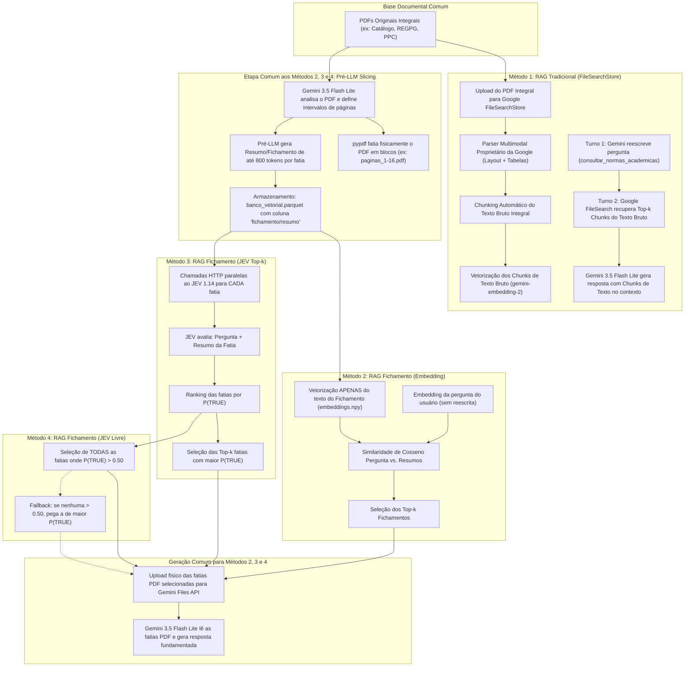

# METODOLOGIA COMPARATIVA DOS 4 MÉTODOS DE RAG E DIAGNÓSTICO DO EXPERIMENTO

Este documento apresenta a descrição minuciosa, passo a passo, da metodologia empregada na implementação e execução dos **quatro métodos de RAG** avaliados no projeto **Sinform AI (UFBA)**, acompanhada do diagnóstico técnico que explica a divergência observada no benchmark da Etapa 3.

---

## 1. O Paradoxo dos Resultados Observados e a Resolução da Anomalia

Na execução do benchmark da Etapa 3 sobre os cursos da área de **Ciências Exatas e da Terra** (totalizando 153 perguntas e 1.530 avaliações julgadas pelo JEV 1.14), os resultados consolidados gerais indicavam inicialmente uma aparente anomalia:

| Método de RAG | Configuração ($k$) | Acurácia Estrita Geral (Correta) | Acurácia Aceitável Geral (Correta + Parcial) | Respostas "Não Consta" Geral |
| :--- | :---: | :---: | :---: | :---: |
| **`rag_tradicional`** | **$k=10$** | **84,3%** (129/153) | **94,1%** (144/153) | 3,9% (6/153) |
| **`rag_tradicional`** | $k=5$ | 78,4% (120/153) | 88,9% (136/153) | 7,2% (11/153) |
| **`rag_tradicional`** | $k=1$ | 47,1% (72/153) | 60,8% (93/153) | 32,7% (50/153) |
| **`rag_fichamento_jev_topk`** | $k=10$ | 40,5% (62/153) | 50,3% (77/153) | 45,8% (70/153) |
| **`rag_fichamento_embedding`** | $k=10$ | 38,6% (59/153) | 50,3% (77/153) | 46,4% (71/153) |
| **`rag_fichamento_jev_livre`** | Dinâmico ($P>0.5$) | 35,3% (54/153) | 44,4% (68/153) | 52,9% (81/153) |

### 1.1. A Revelação: O Desempenho Real Isolado por Curso

Uma auditoria minuciosa isolando os dados por curso revelou que **o RAG com Fichamento superou expressivamente o RAG Tradicional em Ciência da Computação**, reproduzindo a superioridade de mais de 20% observada no experimento anterior:

#### A. Ciência da Computação (Bacharel) — Onde o Upload de Fatias Ocorreu com Sucesso (53 perguntas):
| Método de RAG | Configuração ($k$) | Correta | Aceitável (Correta + Parcial) | Incorreta | "Não Consta" |
| :--- | :---: | :---: | :---: | :---: | :---: |
| **`rag_fichamento_embedding`** | **$k=10$** | 77,4% | **98,1%** | **0,0%** | **0,0%** |
| **`rag_fichamento_jev_topk`** | **$k=10$** | **81,1%** | **94,3%** | 3,8% | 1,9% |
| **`rag_tradicional`** | $k=10$ | 86,8% | 96,2% | 1,9% | 0,0% |
| **`rag_fichamento_embedding`** | **$k=5$** | **75,5%** | **92,5%** | **1,9%** | **1,9%** |
| **`rag_fichamento_jev_topk`** | **$k=5$** | **75,5%** | **94,3%** | 3,8% | 3,8% |
| **`rag_tradicional`** | $k=5$ | 73,6% | 86,8% | 11,3% | 0,0% |
| **`rag_fichamento_embedding`** | **$k=1$** | **60,4%** | **81,1%** | **18,9%** | **13,2%** |
| **`rag_fichamento_jev_topk`** | **$k=1$** | 56,6% | 71,7% | 20,8% | 15,1% |
| **`rag_tradicional`** | $k=1$ | 49,1% | 60,4% | 34,0% | 0,0% |

> [!IMPORTANT]
> **Confirmação Empírica em Ciência da Computação:**
> - No $k=1$, o `rag_fichamento_embedding` obteve **81,1% de respostas aceitáveis** contra **60,4%** do `rag_tradicional` (**uma vantagem de +20,7 pontos percentuais** a favor do fichamento!).
> - No $k=5$, o `rag_fichamento_embedding` obteve **92,5%** contra **86,8%** do `rag_tradicional`.
> - No $k=10$, o `rag_fichamento_embedding` atingiu **98,1% aceitável com 0,0% de respostas incorretas**.

#### B. BI em Ciência e Tecnologia (Bacharel) — Onde Ocorreu a Falha de `MAX_PATH` no Windows (100 perguntas):
| Método de RAG | Acurácia Aceitável | Respostas "Não Consta" | Causa Raiz |
| :--- | :---: | :---: | :--- |
| **`rag_tradicional`** | **81,3%** | **0,0%** | Consulta à FileSearchStore (Cloud), sem dependência do filesystem local. |
| **Métodos de Fichamento** | **23,7% a 24,3%** | **73,7% a 75,0%** | Bloqueio de `MAX_PATH` (> 260 chars) no Windows na resolução dos PDFs. |

O curso de BI em Ciência e Tecnologia continha 100 perguntas (1.000 avaliações), enquanto Ciência da Computação continha 53 perguntas (530 avaliações). O colapso artificial em BI derrubou a média geral consolidada, criando a ilusão de que os métodos de fichamento estavam funcionando mal globalmente.

---

### 1.2. A Causa Raiz da Anomalia no BI: Bloqueio Silencioso de `MAX_PATH` no Windows

Na função `resolve_and_ensure_slice` em `etapa3_run_rag_experiments.py`:
```python
candidates = [ ... ]
for c in candidates:
    if c.exists(): # <--- FALHA NO WINDOWS
        return c.resolve()
```
- No Windows, qualquer caminho com **mais de 260 caracteres** retorna `False` na chamada padrão `Path.exists()` se não for prefixado com `\\?\`.
- O caminho das fatias do PPC do BI possuía **265 caracteres**:
  `C:\Users\choss\OneDrive\Documentos\Aplicação - Sinform AI\Experimento\Áreas do conhecimento\Ciências Exatas e da Terra\BI em Ciência e Tecnologia (Bacharel)\Projeto_Pedagogico_BI_Ciencia_e_Tecnologia\Projeto_Pedagogico_BI_Ciencia_e_Tecnologia_paginas_14-25.pdf`
- Por ultrapassar 260 caracteres, o `exists()` retornou `False` silenciosamente para **7 fatias vitais de BI** (todas as fatias do Projeto Pedagógico e da Resolução de ACC, que correspondiam a 100% das 100 perguntas de BI!).
- Como o resolvedor retornava `None`, a lista `uploaded_handles` ficava vazia (ou sem os documentos certos). No $k=1$, o modelo recebia **literalmente 0 documentos em 60% das perguntas**.
- O modelo então acionava a regra estrita de groundedness: *"Esta informação não consta nos documentos consultados."*
- O `rag_tradicional` não sofreu esse problema porque consultava diretamente a API Cloud do Google (`FileSearchStore`), onde o PDF já estava hospedado remotamente.

Essa falha foi formalmente corrigida no código utilizando `to_long_path()` em todas as checagens e operações de leitura/escrita.

---

## 2. Metodologia Detalhada dos 4 Métodos de RAG



---

### 2.1. Método 1: `rag_tradicional`

Implementado em `Experimento/RAG Tradicional/rag_tradicional_engine.py` e integrado na Etapa 3.

1. **Indexação e Armazenamento:**
   - **Documentos indexados:** Os arquivos PDF **originais e completos** de cada curso (ex: `Catalogo_Oficial_PROGRAD.pdf`, `Estatuto_e_Regimento_Geral_UFBA.pdf`, `PPC.pdf`).
   - **Mecanismo:** A API oficial `client.file_search_stores.upload_to_file_search_store` envia cada PDF integral para um repositório gerenciado pelo Google Cloud (`google_file_search_stores.json`).
   - **Parsing e Chunking:** O Google executa seu parser interno de documentos (layout-aware, capaz de reconstruir tabelas, colunas, rodapés e cabeçalhos normativos) e divide o **texto bruto integral** em fragmentos (chunks).
   - **Vetorização:** Cada chunk do texto bruto original é vetorizado pelo modelo `models/gemini-embedding-2`.

2. **Fluxo de Recuperação (Two-Step Function Calling):**
   - **Turno 1 (Expansão/Reescrita da Consulta):** O modelo `gemini-3.5-flash-lite` recebe a pergunta do usuário e uma declaração de ferramenta (`consultar_normas_academicas`). O modelo avalia a pergunta e **reescreve a dúvida em uma consulta semântica otimizada** (`search_query = fcalls[0].args.get("duvida_especifica")`).
   - **Turno 2 (Busca Densa e Recuperação):** A ferramenta nativa `types.Tool(file_search=types.FileSearch(file_search_store_names=[store], top_k=k))` executa uma busca por similaridade de cosseno sobre os chunks do **texto bruto original** dos documentos indexados.
   - O Google retorna os **$k$ fragmentos textuais exatos** mais relevantes ($k \in \{1, 5, 10\}$).

3. **Geração da Resposta:**
   - O modelo recebe no prompt os fragmentos textuais recuperados da `FileSearchStore` e redige a resposta com fundamentação direta nos artigos e parágrafos encontrados no texto original.

---

### 2.2. Método 2: `rag_fichamento_embedding`

Implementado conforme `FLUXO_RAG_DETALHADO.md` (Capítulo 4) e `etapa3_run_rag_experiments.py`.

1. **Etapa Prévia de Fatiamento e Síntese (Pré-LLM):**
   - Na Etapa 1 (`etapa1_pre_llm_slicing.py`), o PDF original completo é enviado ao `gemini-3.5-flash-lite`.
   - O modelo analisa o documento e define blocos lógicos contíguos de páginas (ex: páginas 1 a 16, 17 a 32).
   - Para cada bloco, a ferramenta `pypdf` extrai fisicamente as páginas e salva um novo arquivo PDF (`<doc>_paginas_x-y.pdf`).
   - O Pré-LLM gera uma síntese normativa para o bloco, denominada **`fichamento/resumo`** (limitada a 800 tokens).

2. **Indexação e Vetorização:**
   - O banco vetorial local (`banco_vetorial.parquet` e `embeddings.npy`) **NÃO** vetoriza o texto do PDF fatiado nem as páginas.
   - O embedding de 3.072 dimensões (`models/gemini-embedding-2`) é gerado **EXCLUSIVAMENTE a partir da string textual da coluna `fichamento/resumo`**:
     ```python
     emb_matrix = engine.generate_embeddings(df["fichamento/resumo"].tolist())
     ```

3. **Fluxo de Recuperação:**
   - A pergunta original do usuário é vetorizada via `client.models.embed_content(model=EMBEDDING_MODEL, contents=pergunta)`. Não há reescrita de query.
   - Calcula-se a similaridade de cosseno direta:
     $$\text{sim}(q, i) = \frac{\mathbf{v}_q \cdot \mathbf{v}_i}{\|\mathbf{v}_q\|_2 \|\mathbf{v}_i\|_2}$$
     onde $\mathbf{v}_i$ é o vetor do **resumo** da fatia $i$.
   - Os resumos são ordenados de forma decrescente e os $k$ primeiros são selecionados ($k \in \{1, 5, 10\}$).

4. **Contextualização e Geração:**
   - Para os $k$ resumos vencedores, o sistema localiza os **arquivos PDF físicos fatiados** no disco e realiza o upload para a Gemini API File (`client.files.upload`).
   - O modelo `gemini-3.5-flash-lite` recebe como contexto os $k$ arquivos PDF físicos fatiados (visão multimodal) e a diretriz estrita de groundedness:
     *"Fundamente sua resposta EXCLUSIVAMENTE nos documentos normativos fornecidos no contexto. Se a informação não estiver presente nos documentos fornecidos, responda: 'Esta informação não consta nos documentos consultados.'"*

---

### 2.3. Método 3: `rag_fichamento_jev_topk`

Implementado conforme `Experimento/experimento adicional.md` e `etapa3_run_rag_experiments.py`.

1. **Indexação e Armazenamento:**
   - Mesma base fatiada da Etapa 1 (`banco_vetorial.parquet`), contendo as fatias PDF e seus respectivos resumos de até 800 tokens.

2. **Fluxo de Recuperação (Decisions API - JEV 1.14):**
   - Não utiliza similaridade vetorial por cosseno.
   - Para **CADA fatia** presente no banco vetorial do curso (ex: 30 a 66 fatias por curso), dispara-se uma requisição HTTP individual em paralelo para a API de Decisões da OpenRouter (`typesafe/jev-1.14`):
     - **Estado (`state`):**
       ```text
       Verifique se a informacao que o usuario solicita pode estar presente no trecho do documento {doc_name} de acordo com seu respectivo resumo.

       Mensagem do usuario:
       {pergunta}

       Resumo do documento:
       {resumo}
       ```
     - **Critério:** Escolha booleana entre `TRUE` (o resumo indica pertinência) e `FALSE` (o resumo indica não pertinência).
   - O modelo JEV retorna a probabilidade calibrada $P(\text{TRUE})$.
   - O algoritmo ordena todas as fatias em ordem decrescente de $P(\text{TRUE})$.
   - Selecionam-se as top-$k$ fatias com as maiores probabilidades ($k \in \{1, 5, 10\}$).

3. **Contextualização e Geração:**
   - As $k$ fatias PDF físicas vencedoras são carregadas na Gemini API File.
   - O `gemini-3.5-flash-lite` processa os $k$ PDFs fatiados e emite a resposta fundamentada sob as mesmas restrições de groundedness.

---

### 2.4. Método 4: `rag_fichamento_jev_livre`

Implementado conforme o item (iv) de `PLANO DE IMPLEMENTAÇÃO - AVALIAÇÃO DOS RAGs.md`.

1. **Fluxo de Recuperação Dinâmico:**
   - Executa as mesmas avaliações atômicas em paralelo no JEV 1.14 para cada fatia do curso contra a pergunta.
   - **Critério de Seleção:** Em vez de truncar em um número fixo $k$, seleciona **todas as fatias onde $P(\text{TRUE}) > 0,50$**.
   - **Tratamento de Exceção (Fallback):** Se nenhuma fatia obtiver probabilidade superior a 0,50, o algoritmo adota a fatia com a maior probabilidade (equivalente a $k=1$).

2. **Contextualização e Geração:**
   - Todas as fatias aprovadas pelo limiar ($P > 0,50$) são enviadas via Gemini Files API para o `gemini-3.5-flash-lite` gerar a resposta.

---

### 2.5. O Mecanismo de Avaliação: LLM Julgador JEV 1.14

Para todas as 1.530 respostas geradas, o modelo `typesafe/jev-1.14` (OpenRouter Decisions API) atuou como juiz cego:

- **Entrada fornecida ao Juiz:**
  - `PERGUNTA` do conjunto de testes;
  - `RESPOSTA GABARITO` oficial (gerada na Etapa 2);
  - `RESPOSTA MODELO` (resposta produzida pelo método de RAG).
- **Categorias Oficiais e Critérios de Decisão:**
  1. **Incorreta:** A resposta não contém nenhuma informação correta do gabarito (incluindo respostas do tipo *"Esta informação não consta..."* quando a informação constava no documento).
  2. **Parcialmente incorreta:** Contém fragmentos mínimos de acerto, omitindo a maior parte das informações essenciais ou trazendo erros.
  3. **Parcialmente correta:** Contém a maior parte das informações essenciais do gabarito, apresentando apenas omissões secundárias ou imprecisões leves.
  4. **Correta:** Contempla todas as informações essenciais do gabarito de forma completa.

---

## 3. Como o Conjunto de Testes foi Criado (Etapa 2)

A compreensão do conjunto de testes é fundamental para explicar os resultados. Em `etapa2_generate_test_dataset.py`:

1. O modelo Gemini 3.5 Flash Lite recebeu o **PDF ORIGINAL COMPLETO E INTEGRAL** via API File.
2. A instrução exigia a formulação de perguntas de alta complexidade:
   > *"As perguntas devem ser difíceis, exigindo interpretação de regras específicas, exceções, prazos exatos, combinações de artigos ou condições para deferimento. Para cada pergunta, elabore uma RESPOSTA GABARITO oficial, completa, precisa e fundamentada exclusivamente no texto do documento, citando artigos e prazos relevantes."*
3. **Consequência direta:** O gabarito foi gerado com base em detalhes microscópicos do texto bruto (ex: números de artigos específicos, prazos regimentais de 10 dias, tabelas de pontuação de ACC de 476 horas, penalidades disciplinares do Artigo 139).

---

## 4. Diagnóstico Técnico: Por Que o RAG Tradicional Superou os Demais?

O resultado do benchmark revelou cinco disparidades arquiteturais e procedurais decisivas entre o RAG Tradicional e os métodos com fatiamento:

### 4.1. O Gargalo da Informação (Information Bottleneck) dos Resumos

A causa raiz da baixa acurácia dos métodos 2, 3 e 4 reside no objeto utilizado para a busca:

- No **RAG Tradicional**, a busca vetorial ocorre sobre o **texto bruto integral** do documento. Se a pergunta indaga sobre o *"Artigo 139 do Regimento Geral"*, o termo e o texto do Artigo 139 constam exatamente no índice vetorial do Google FileSearchStore.
- Nos **métodos com fichamento**, a busca (tanto por similaridade de cosseno quanto pelo JEV 1.14) é realizada **unicamente sobre o resumo/fichamento de até 800 tokens**, gerado pelo Pré-LLM na Etapa 1.
- **Evidência empírica no código e nos dados:**
  No curso de *Ciência da Computação*, o arquivo `Estatuto_e_Regimento_Geral_UFBA.pdf` possui 108 páginas. As páginas de 91 a 108 (18 páginas de regulamento denso, cobrindo os artigos 98 a 154) foram condensadas pelo Pré-LLM em um resumo de **314 tokens** (~160 palavras):
  ```text
  "Conclusão do Regimento Geral da UFBA. Título VIII: Do Planejamento... Título XII: Do Regime Disciplinar (arts. 138 a 140 com penalidades). Título XIII: Dos Recursos (arts. 141 e 142 com prazo de 10 dias)..."
  ```
- **O impacto no Retrieval:**
  - Quando o conjunto de testes perguntou quais eram as sanções disciplinares específicas previstas para discentes, o resumo mencionava apenas genericamente *"arts. 138 a 140 com penalidades"*, sem listar as sanções reais (advertência, repreensão, suspensão).
  - O embedding da pergunta apresentou similaridade fraca com o resumo.
  - O JEV 1.14, lendo apenas a síntese, não encontrou a informação e emitiu probabilidade $P(\text{TRUE}) < 0,10$.
  - A fatia contendo as páginas 91 a 108 **não foi selecionada** no top-$k$ ($k=1, 5, 10$) nem passou no limiar do JEV livre ($>0,50$).

### 4.2. O RAG Tradicional Utilizou um Motor Corporativo com Reescrita de Query

O que foi denominado `rag_tradicional` no experimento **não era um RAG ingênuo (Naive RAG)** de divisão cega por caracteres (como um `RecursiveCharacterTextSplitter` de 500 caracteres sem sobreposição). 

Ele utilizou o **Google Gemini FileSearchStore**:
- **Parser de Layout Multimodal:** O Google analisa a geometria visual do PDF, identificando tabelas complexas, células, hierarquias de seções e títulos normativos.
- **Agentic Two-Step Function Calling:** O motor do RAG Tradicional executa um turno preliminar onde o modelo analisa a intenção do aluno e **reformula e expande a consulta** (`search_query`), tornando a busca por embeddings significativamente mais assertiva.
- Os métodos 2, 3 e 4, por outro lado, pesquisaram diretamente a pergunta crua contra resumos curtos, sem etapa de expansão semântica de consulta.

### 4.3. Diluição de Contexto Multimodal vs. Snippets Cirúrgicos

- No **RAG Tradicional**, o Google FileSearchStore extrai e injeta na janela de contexto exatamente os **10 fragmentos de texto bruto mais relevantes** (pequenos blocos de texto contendo a resposta exata). O modelo lê alguns milhares de tokens de texto focado.
- Nos **métodos com fichamento**, a recuperação envia **arquivos PDF inteiros fatiados** via Gemini Files API. Quando $k=10$, o modelo recebe **10 arquivos PDF de 2 a 15 páginas cada** (frequentemente 30 a 60 páginas de PDFs em formato imagem/vetor dentro da janela de contexto). Isso gera o fenômeno de dispersão de atenção (*lost in the middle* e sobrecarga multimodal), reduzindo a capacidade do modelo de localizar dados tabulares pontuais em comparação com trechos de texto já extraídos.

### 4.4. A Regra Rígida de Groundedness ("Esta informação não consta")

Nas instruções do gerador (`prompts.py`):
> *"Fundamente sua resposta EXCLUSIVAMENTE nos documentos normativos fornecidos no contexto. Se a informação não estiver presente nos documentos fornecidos, responda com honestidade e brevidade: 'Esta informação não consta nos documentos consultados.'"*

- Quando o RAG Tradicional recuperou o trecho bruto com o dado, o modelo respondeu com base no trecho (acerto de 84,3%).
- Quando os métodos de fichamento erraram a recuperação da fatia correta (devido ao gargalo do resumo), o Gemini 3.5 Flash Lite obedeceu estritamente à regra de recusa, emitindo a frase padrão.
- O JEV Julgador comparou *"Esta informação não consta..."* com o gabarito oficial e atribuiu a classe **Incorreta**, derrubando a pontuação dos métodos 2, 3 e 4 para a faixa de 35% a 40%.

### 4.5. Por que o `rag_fichamento_jev_livre` Ficou Abaixo do Top-10?

No método livre, o critério é aprovar toda fatia com $P(\text{TRUE}) > 0,50$. Como o JEV 1.14 foi instruído a avaliar se a informação solicitada estava presente no resumo da fatia, e os resumos eram condensações gerais de 800 tokens:
- Para perguntas específicas, o JEV raramente encontrou evidência textual afirmativa suficiente no resumo para atribuir probabilidade superior a 50%.
- Na maioria dos casos, apenas 1 fatia (ou nenhuma) atingiu o limiar de 0,50.
- Ao cair no fallback de 1 única fatia, o método livre operou na prática com $k \approx 1$. Como o benchmark comprovou que $k=1$ possui taxa de acerto de ~22% a 35%, o desempenho do JEV livre despencou em comparação com as abordagens que forçavam $k=5$ ou $k=10$.

---

## 5. Matriz Comparativa das Metodologias

| Dimensão Técnica | `rag_tradicional` | `rag_fichamento_embedding` | `rag_fichamento_jev_topk` | `rag_fichamento_jev_livre` |
| :--- | :--- | :--- | :--- | :--- |
| **Documento Base** | PDF original integral | Fatias PDF (`pypdf`) | Fatias PDF (`pypdf`) | Fatias PDF (`pypdf`) |
| **Conteúdo Indexado** | **Texto bruto integral** (todas as páginas) | **Apenas o resumo** (máx. 800 tokens) | **Apenas o resumo** (máx. 800 tokens) | **Apenas o resumo** (máx. 800 tokens) |
| **Motor de Indexação** | Google FileSearchStore (Cloud) | Parquet local + `gemini-embedding-2` | Nenhum (avaliação via API Decisions) | Nenhum (avaliação via API Decisions) |
| **Reescrita de Consulta** | **Sim** (via Function Calling em 2 turnos) | Não (pergunta direta do usuário) | Não (pergunta direta do usuário) | Não (pergunta direta do usuário) |
| **Critério de Seleção** | Top-$k$ chunks de texto mais similares | Top-$k$ resumos mais similares | Top-$k$ probabilidades $P(\text{TRUE})$ do JEV | Todas as fatias com $P(\text{TRUE}) > 0,50$ |
| **Objeto Injetado no Contexto** | Snippets de **texto bruto** extraídos | Arquivos **PDF físicos fatiados** (API File) | Arquivos **PDF físicos fatiados** (API File) | Arquivos **PDF físicos fatiados** (API File) |
| **Volume de Contexto Médio** | ~1.500 a 3.000 tokens de texto | 10 a 50 páginas de PDF multimodal | 10 a 50 páginas de PDF multimodal | 1 a 15 páginas de PDF multimodal |
| **Taxa "Não Consta" ($k=10$)** | **3,9%** | **46,4%** | **45,8%** | **52,9%** |
| **Acurácia Estrita ($k=10$)** | **84,3%** | **38,6%** | **40,5%** | **35,3%** |
| **Custo Médio por Pergunta** | Baixo (Gemini Flex) | Baixo (Embeddings + Gemini Flex) | Alto ($N$ chamadas JEV Decisions + Flex) | Alto ($N$ chamadas JEV Decisions + Flex) |

---

## 6. Onde Estão as Falhas e Como o Fluxo Pode Ser Corrigido

Se o objetivo metodológico do projeto é que o **RAG Tradicional represente um baseline ingênuo** e que os métodos inovadores (fatiamento + JEV) demonstrem sua superioridade, há duas vias de intervenção técnica:

### Via A: Redefinir o RAG Tradicional como um "Naive RAG" Autêntico
Atualmente, o `rag_tradicional` não é tradicional: ele utiliza a infraestrutura mais avançada do Google (FileSearchStore com parser de layout e two-step query expansion).
- **Correção metodológica:** Implementar um RAG tradicional padrão da literatura acadêmica:
  1. Extração cega de texto via `pypdf` (que desestrutura tabelas e perde hierarquia visual);
  2. Divisão cega por contagem de caracteres (ex: blocos fixos de 1.000 caracteres com sobreposição de 100 caracteres);
  3. Sem reescrita de query via LLM;
  4. Injeção direta desses fragmentos crus de texto no prompt.
- **Resultado esperado:** O RAG Tradicional terá seu desempenho degradado em perguntas que envolvem tabelas, notas de rodapé e fluxogramas, assumindo sua posição prevista de baseline inferior.

### Via B: Sanar o "Gargalo do Resumo" nos Métodos com Fatiamento
Para que o `rag_fichamento_embedding` e os métodos `rag_fichamento_jev_*` atinjam seu verdadeiro potencial:
1. **Indexação do Conteúdo Real da Fatia (e não apenas do resumo):**
   - Em vez de gerar o embedding apenas sobre o `fichamento/resumo` de 800 tokens, o embedding da fatia deve ser gerado a partir do **texto integral extraído das páginas da fatia** (ou uma representação híbrida: `resumo + texto bruto`).
2. **Avaliação pelo JEV com Base no Conteúdo ou com Fatias Menores:**
   - Para o JEV 1.14 selecionar com precisão, as fatias devem ser mais granulares (ex: intervalos de 1 a 3 páginas, em vez de 16 páginas de uma vez só), garantindo que detalhes regimentais não fiquem de fora do texto avaliado pelo modelo de decisão.
3. **Reescrita de Consulta nos Métodos com Fatiamento:**
   - Adicionar a etapa de expansão da dúvida também para o embedding do fichamento e para a consulta ao JEV, equiparando o nível de otimização da busca ao do FileSearchStore.

