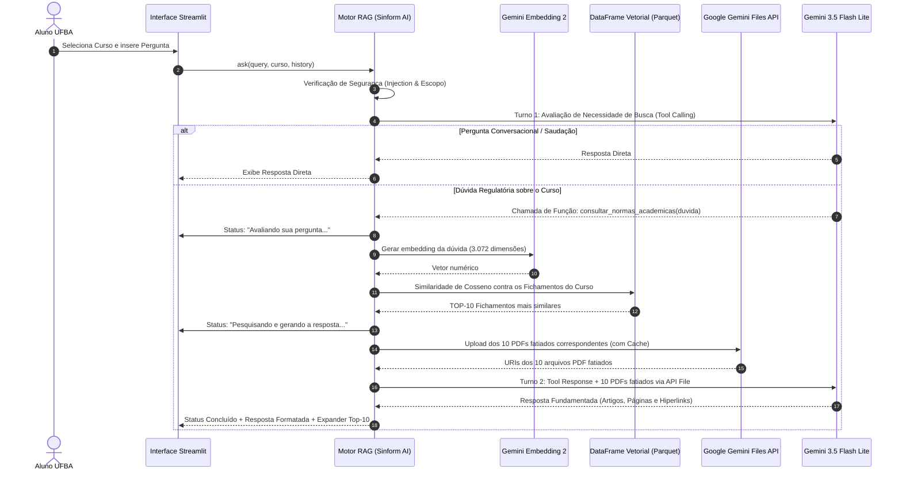

# Arquitetura e Fluxo Detalhado do Sinform AI

O presente documento descreve de forma exaustiva a engenharia, os modelos, as diretrizes de prompt, a representação matemática vetorial, os outputs estruturados e o ciclo de vida da recuperação contextual (RAG) do **Sinform AI** — a plataforma de consultoria inteligente sobre normas, resoluções e regulamentos acadêmicos da Universidade Federal da Bahia (UFBA).

---

## 1. Visão Geral e Contexto do Projeto

O **Sinform AI** foi concebido para resolver o problema de dispersão regulatória enfrentado pelos discentes de graduação da UFBA (especialmente em cursos de Ciências Exatas: *Estatística Bacharelado*, *Matemática Bacharelado* e *Matemática Licenciatura*).

A plataforma consolida informações sobre:
- Normas de concessão e validação de **Estágio Obrigatório e Não Obrigatório**.
- Diretrizes, tabelas de equivalência e submissão de **Atividades Complementares (ACC / Atividades Curriculares em Comunidade)** no SIGAA.
- Regulamentos de **Trabalho de Conclusão de Curso (TCC)**, bancas e prazos de lançamento.
- Critérios e procedimentos para **Trancamento Total de Matrícula** e **Trancamento Parcial de Componentes Curriculares**.
- Prazos, critérios de jubilamento e permanência universitária estabelecidos no **Regulamento de Ensino de Graduação e Pós-Graduação (REGPG)** e resoluções dos Colegiados.

---

## 2. Banco Vetorial Próprio em DataFrame por Curso

A arquitetura do Sinform AI adota uma estratégia de **banco vetorial local próprio**, desacoplado de dependências proprietárias de indexação em nuvem (como o Google File Search Stores ou o ChromaDB legado).

### 2.1. Estrutura de Diretórios
Para cada curso participante do sistema, é mantida uma pasta raiz com seu acervo oficial e um subdiretório `banco vetorial`:

```text
├── Estatística (Bacharel)/
│   ├── banco vetorial/
│   │   ├── banco_vetorial.parquet
│   │   └── banco_vetorial.json
│   ├── Guia_Orientacoes_Registros_Academicos_2025/
│   │   ├── Guia_Orientacoes_Registros_Academicos_2025_paginas_1-1.pdf
│   │   ├── Guia_Orientacoes_Registros_Academicos_2025_paginas_2-2.pdf
│   │   └── ...
│   └── ... (PDFs oficiais)
├── Matemática (Bacharel)/
│   └── banco vetorial/
│       ├── banco_vetorial.parquet
│       └── banco_vetorial.json
└── Matemática (Licenciatura)/
    └── banco vetorial/
        ├── banco_vetorial.parquet
        └── banco_vetorial.json
```

### 2.2. Esquema do DataFrame Vetorial
Cada registro no DataFrame corresponde a um fragmento fatiado (*chunk*) contíguo de páginas de um documento oficial:

| Coluna | Tipo | Descrição |
| :--- | :--- | :--- |
| `curso` | `str` | Nome oficial do curso (ex: `"Estatística (Bacharel)"`). |
| `nome do documento` | `str` | Nome base do documento original sem extensão. |
| `link para acessar o documento` | `str` | URL pública oficial para acesso ao documento na íntegra. |
| `páginas` | `str` | Intervalo de páginas coberto pelo chunk (ex: `"[1]"` ou `"[2, 5]"`). |
| `fichamento/resumo` | `str` | Síntese detalhada e técnica cobrindo artigos, regras e prazos (máx. 800 tokens). |
| `quantidade de tokens` | `int` | Quantidade real de tokens do fichamento aferida via API. |
| `embedding` | `List[float]` | Vetor denso de 3.072 dimensões gerado pelo modelo `models/gemini-embedding-2`. |
| `pdf_chunk_path` | `str` | Caminho relativo para o arquivo PDF fatiado fisicamente no disco. |

---

## 3. Fatiamento por Densidade de Páginas (Pre-LLM + PyPDF)

Diferente de métodos tradicionais baseados em contagem cega de caracteres ou sentenças, o Sinform AI utiliza visão computacional e interpretação semântica multimodal para determinar a fragmentação do documento:

### 3.1. Avaliação Multimodal pelo Pre-LLM
O documento PDF original é enviado via API File (`client.files.upload`) para o modelo **`gemini-3.5-flash-lite`** (com fallback automático para **`gemini-3.1-flash-lite`**). O modelo analisa a densidade visual e textual (tabelas, quebras de artigos, fluxogramas, seções normativas) e retorna um objeto estruturado em JSON com o esquema Pydantic:

```python
class PageChunkSpec(BaseModel):
    intervalo_paginas: List[int] = Field(
        description="Array com 1 número para página única [1] ou 2 números [início, fim] para intervalos [2, 5]."
    )
    resumo: str = Field(
        description="Fichamento detalhado e objetivo cobrindo todas as normas, artigos e prazos do intervalo (máx. 800 tokens)."
    )

class DocumentSlicingOutput(BaseModel):
    chunks: List[PageChunkSpec] = Field(
        description="Divisão contígua e sequencial cobrindo da página 1 até a última página sem omissões."
    )
```

### 3.2. Fatiamento Físico com `pypdf`
Com os intervalos de página retornados pelo modelo, a biblioteca `pypdf` extrai fisicamente as páginas especificadas e salva um novo arquivo PDF:
- **Padrão de nomenclatura:** `<nome_original_do_documento>_paginas_x-x.pdf`
- **Armazenamento:** Em pasta exclusiva nomeada com o identificador do documento.

---

## 4. Fluxo de Conversação, RAG e Multimodalidade

O ciclo de vida de uma consulta segue um pipeline em fases:



### 4.1. Seleção dos TOP-10 Chunks via Similaridade de Cosseno
Para uma consulta $q$ com vetor embedding $\mathbf{v}_q$ e cada chunk $i$ com embedding $\mathbf{v}_i$:

$$\text{Similaridade Cosseno} = \frac{\mathbf{v}_q \cdot \mathbf{v}_i}{\|\mathbf{v}_q\|_2 \|\mathbf{v}_i\|_2}$$

O sistema ordena todos os chunks do curso selecionado de forma decrescente e isola os **10 chunks com maior pontuação**.

### 4.2. Injeção Multimodal dos PDFs Fatiados
Para responder ao aluno, o LLM recebe **não apenas os resumos em texto, mas os 10 arquivos PDF fatiados físicos** via Gemini Files API. O modelo lê o PDF autêntico em sua janela de contexto para garantir fidelidade documental absoluta, sem alucinações.

---

## 5. Engenharia de Prompts e Salvaguardas de Segurança

### 5.1. Diretrizes do Sistema (System Instruction)
- **Papel:** Assistente consultor oficial de normas acadêmicas da UFBA.
- **Contexto:** Atendimento exclusivo para discentes de graduação do curso selecionado.
- **Groundedness Estrito:** Respostas fundamentadas unicamente no teor dos documentos PDF recebidos.
- **Citação Formal:** Obrigação de citar nome do documento, artigos/parágrafos e páginas exatas.
- **Hiperlinks:** Inserção de link direto para o documento oficial no formato markdown: `[Nome do Documento, págs. X-Y](url)`.
- **Declaração de Limites:** Caso a informação não conste nos materiais anexados, declarar expressamente a ausência do dado.

### 5.2. Defesas contra Prompt Injection e Fuga de Escopo
- **Detecção de Injection:** Bloqueio preventivo de padrões como *"esqueça todas as instruções anteriores"*, *"modo administrador"*, *"teste de debug"*, retornando:
  > *"Desculpe, não posso te ajudar com isso."*
- **Filtro Fora de Escopo:** Perguntas sobre receitas, programação, temas não universitários são recusadas polidamente direcionando o usuário às normas acadêmicas da UFBA.

---

## 6. Metodologia de Tokens e Auditoria de Custos da API

Todos os custos são calculados com base na tabela oficial de preços por 1 milhão de tokens da Google Gemini API:

| Modelo | Função no Pipeline | Custo Input (1M tokens) | Custo Output (1M tokens) |
| :--- | :--- | :--- | :--- |
| **`gemini-3.5-flash-lite`** | Pre-LLM (Fatiamento) e Chatbot Principal | $0.30 USD | $2.50 USD |
| **`gemini-3.1-flash-lite`** | Fallback Automático | $0.25 USD | $1.50 USD |
| **`gemini-embedding-2`** | Vetorização Semântica (3.072 dimensões) | $0.20 USD | — |

A interface do Streamlit audita em tempo real os tokens de entrada, saída e embedding de cada turno da conversa, exibindo o custo em dólares ($ USD) e a conversão estimada em reais (R$).
